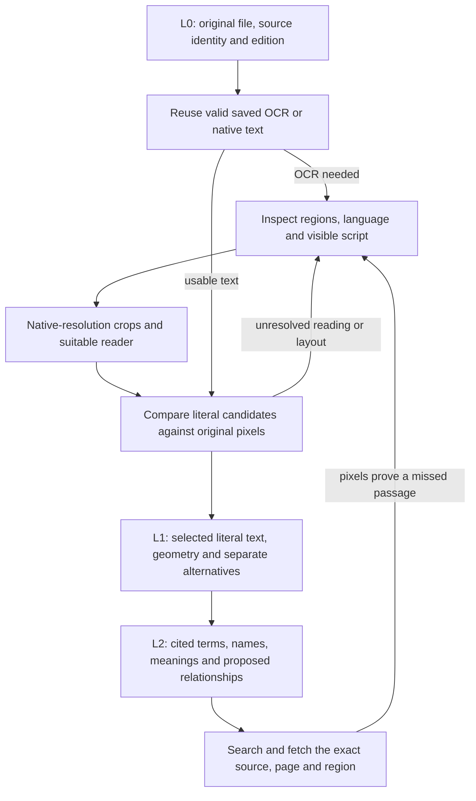

# Koshirai

Koshirai turns Japanese sword pages into traceable text, terms, names and cited
meanings. It keeps the original lettering separate from lookup variants, English
interpretation and historical identity. A plausible smith name is not proof of a reading.

The public package provides OCR adapters, layout and entry parsing, cited meaning
selection, and review/import contracts. Full-book visual review, complete English
translation and PostgreSQL storage are deployment responsibilities; the `scan`
command does not automatically perform them. Private books, scans and passages
stay outside public releases. Public examples retain their rights and attribution.

## One end-to-end process



**L0 is the evidence; L1 says what is written; L2 says what that writing supports.**
Keep the work's composition, surviving copy, reprint and visible script separate.
A modern book can contain a historical facsimile next to a modern caption. Route
those regions separately. A publication year or provider name cannot choose OCR.

Crop from the original resolution and retain the source hash, page, coordinates,
reading order, reader/version and routing reason. Regions include headings,
vertical columns, ruby, marginalia, genealogy, tables, signatures, seals and captions.
Detector boxes and image-caption links remain proposals until reviewed. Invalid
geometry stays unresolved. Never silently replace original glyphs with modern forms.

| Region or task | Reader | Current role |
| --- | --- | --- |
| Valid native text or saved OCR | Retained-OCR input | Reuse before running another reader; preserve named layers. |
| English print | Tesseract LSTM | Implemented for explicitly English regions. |
| Japanese book or magazine print | [NDLOCR-Lite](https://github.com/ndl-lab/ndlocr-lite) | Implemented default; verify old forms and small annotations. |
| Historical manuscript or woodblock | [NDL Koten OCR-Lite](https://github.com/ndl-lab/ndlkotenocr-lite) | Implemented explicit historical-Japanese adapter; upstream targets Japanese works through the Edo period and Chinese classics through the Qing period. |
| Difficult historical vertical line | [Honkoku OCR v19](https://huggingface.co/yuta1984/honkoku-ocr) | External comparison on a single line; no bundled Honkoku adapter or automatic dispatch. |
| Layout or disputed strokes | Source inspection, optionally AI vision | Record the actual reviewer/model and what it saw. Sol is not an automatic acceptance authority. |
| Meaning and relationships | Cited sword library and native parsers | Preserve literal spans, negation, alternatives and source claims. |

Honkoku v19 is Yuta Hashimoto's September 2026 line recognizer for premodern
cursive writing. It can emit reading-gloss and annotation tags. Its 7,710-token
vocabulary bounds what it can represent; vocabulary inclusion does not establish
character accuracy. It does not detect page lines or translate. Ledger layouts and
split-line notes are known weaknesses. See the [model card](https://huggingface.co/yuta1984/honkoku-ocr#kuzushiji-ocr--line-level-recognition-with-annotation-structure).
Use a reviewed, pinned external runtime; it is a comparison reader, not a default.

## When readers disagree

Keep every original output and align candidates to the same source region.
An agreement is supporting evidence, not a vote that establishes truth. Sol can
misread pixels or complete a familiar name; specialist OCR can omit a column or
modernize a glyph. A confident score from one model is not comparable to another's.

Inspect the disputed crop with its surrounding column, separate annotations, and
record the selected reading with its reason. For example, `國` and `国` may share
a lookup link while the transcription retains the visible form. Similar-looking
`冶` and `治` require a stroke check. If the image does not resolve a character,
retain the alternatives or an unreadable span. Translation cannot repair missing evidence.

For a fair comparison, run each reader on identical held-out line crops, then
measure page segmentation separately. Freeze independent reference readings before
viewing predictions. Measure character errors, omitted lines, exact names/dates,
reading order and caption/figure links separately; an overall text score can hide
wrong genealogy. See the [benchmark protocol](benchmarks/README.md#ocr-reader-comparison).
No complete Koten/Honkoku/Sol manuscript benchmark is published here.

## From text to searchable meaning

The four reviewable outputs are literal OCR/general dictionary meanings, complete
terms or names, supported sword readings/English with citations, and alternatives.
Match complete expressions with original offsets. Keep a character, a term, a school,
a smith name and a historical person as different objects. A name match never merges people.

A PostgreSQL deployment stores source identities, reader candidates, reviewed L1
and dependent L2 with one current selection per purpose. Search can follow documented
kanji variants, complete romanized forms, English meanings and cited relationships.
It returns the original page/region and the basis of each link. Missing evidence and
identity conflicts remain visible. A missing hit alone does not prove missing OCR:
inspect the pixels, repair that region, refresh dependent L2, and repeat the query.
Full-page English exports must remain aligned to those same reviewed regions.

The default contextual selector uses source evidence and Japanese boundaries.
Qwen only assists stroke comparison. BERT and Jev are optional role/meaning selectors;
model scores are uncalibrated. The optional Astra/Sol **text-semantic** experiment
is separate from visual transcription; its live comparison remains pending.
See [native semantics](docs/native_semantics.md) and [approaches tried](docs/approaches.md).

## What has been measured

The published 50-page grouping benchmark keeps the original **114 correct / 29
rejected, 79.7% precision, 35.1% recall** result, which missed its 80% precision target.
A declared geometry-counting repair gives 122/21 and 85.3% precision, 37.5% recall.
These are grouping scores against provisional AI references, not OCR or translation
accuracy. [Frozen evidence and reproduction](benchmarks/README.md) preserve both policies.

Honkoku's author reports **6.09% character error versus Koten-Lite's 8.05%** on
58,521 shared test lines from 214 materials, excluding whitespace. The sample
filters out severe NDL errors. This is an upstream comparison, not our manuscript
score or a Sol comparison. [Protocol and limitations](https://huggingface.co/yuta1984/honkoku-ocr#evaluation).

## Install and use

Requires Python 3.12+, a POSIX shell and external disk space. Linux is tested.

```sh
sh setup.sh --install-ocr
export KANJI_DATA_DIR="${XDG_DATA_HOME:-$HOME/.local/share}/kanji-translator"
cli="$KANJI_DATA_DIR/environment/bin/kanji-translator"
"$cli" scan /path/to/scans --semantic-profile contextual --output /path/to/empty-results
```

Outputs include `raw_ndl.txt`, `text.txt`, `terms.jsonl`, `interpretations.jsonl`,
`results.jsonl` and review files. Keep inputs, outputs, environments and models
outside the checkout. See the [researcher guide](docs/researcher_guide.md).
OCR configuration accepts `language=en` with external Tesseract/English data, or
`backend=koten`, `language=ja`, `script=historical` and external `koten_package`.
The adapters record external engine hashes; unsupported backends are rejected.
Add `--install-bert` for BERT; Jev needs `TYPESAFE_API_KEY` and the `jev` profile.
[Offline Jev replay](docs/jev_research.md) requires no key. No paid inference starts by default.

## Contribute

Provide permitted complete spellings, readings/English, categories, exact citations
and review status. Preserve conflicts and independent source boundaries. Library
updates improve retrieval without retraining. Training/evaluation must split by work.
Fork current main and submit reproduction steps and before/after evidence. Run tests,
`git diff --check` and the release checks. Never commit private passages, scans,
credentials or corpus databases. Follow the [contribution guide](docs/reviewed_contributions.md).
[MIT](LICENSE) covers original code; [third-party notices](docs/notices/third_party_data.md)
cover separate software and data terms. External models keep their own licenses.
