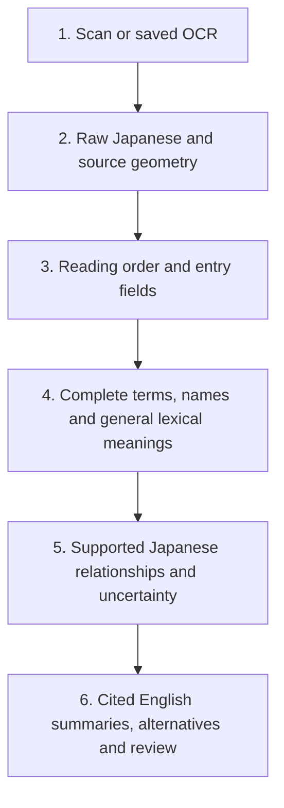

# Koshirai

Koshirai turns Japanese sword pages into four reviewable results:

1. Original OCR and general dictionary meanings.
2. Complete expressions identified as terms or names.
3. Supported sword readings and English meanings, with source citations.
4. Alternative matches and unresolved cases.

Japanese characters, offsets and source evidence stay authoritative. English
summaries follow supported term and relationship selection. General dictionary
lookup remains a lexical comparison; the application does not translate whole pages.

The sword library derives bounded facts from legally purchased private references.
Public releases use pseudonymous citations and exclude private books, scans and
passages. Required attribution and public-domain benchmark samples remain.

## Pipeline and tools



A complete spelling in a sword page can retrieve a documented meaning from the
reference library. Eighteen bilingual mappings now link grain and temper-pattern
terms to separate Japanese and English page citations. Saved OCR can enter the
same interpretation process directly.

| Tool | Role |
| --- | --- |
| NDLOCR-Lite | Extracts literal characters and native page regions. |
| Layout and entry parser | Orders columns, separates entries, reads explicit name/era/province fields, and proposes illustration links. |
| Qwen stroke vision | Optional separate inspection of similar character shapes in bounded crops. It does not select meanings or identities. |
| Dictionary and sword library | Supply ordinary meanings, complete sword terms, names, readings, categories and citations. |
| Source-priority selector | Default local selection using source evidence, Japanese boundaries and entry context. |
| Native clause parser | Proposes bounded relationships with original argument/predicate spans, negation and uncertainty. Produces English only where supported. |
| BERT classifier | Optional local classification of a supported expression's role, such as smith, school or place. |
| Jev decision model | Optional hosted role/meaning selection from bounded candidates. |
| Astra/Sol experiment | Separate opt-in comparison runner with identical Japanese inputs and closed candidates. Live comparison is pending; no superiority is established. |
| Review and corpus tools | Retain corrections and alternatives; import observations without duplication. |

BERT means *Bidirectional Encoder Representations from Transformers*. Its scores
are uncalibrated. Model proposals and name matches do not establish historical
identities. Ordinary scans make no frontier-model calls.

## Measured results

These exposed development results use provisional AI references, not expert
translation judgments. The same 50 Fujishiro pages and OCR are compared below
using the original area-overlap counting rule.

| Method | Correct groups | Rejections | Precision | Recall |
| --- | ---: | ---: | ---: | ---: |
| Current native entry selection | 114 | 29 | 79.7% | 35.1% |
| Previous default | 61 | 20 | 75.3% | 18.8% |
| Earlier BERT snapshot | 51 | 11 | 82.3% | 15.7% |
| Earlier Jev snapshot | 30 | 4 | 88.2% | 9.2% |

Image review found that narrow whole-line boxes can fail the old area test despite
covering the reference term. A documented axis-overlap repair, applied to both
releases, gives **122 correct / 21 rejected**, versus **64 / 17** previously:
85.3% versus 79.0% precision. The original 79.7% result remains visible because it
misses the declared 80% target. References, sources and OCR were not changed.

The saved-OCR pilot retains 37/37 cited English selections and withholds both
nested controls. Twelve reviewed native lines yield 8 of 15 reference relationships,
with no extra claims and seven misses. Fifteen entry cases across six fresh pages
were reviewed. OCR errors and unresolved boundaries remain visible.

See [native semantics and limitations](docs/native_semantics.md),
[counting and reproduction](benchmarks/README.md), and
[approaches tried](docs/approaches.md). Expert English accuracy remains unmeasured.

## Install and use

Requires Python 3.12+, a POSIX shell and external disk space. Linux is tested.

```sh
sh setup.sh --install-ocr
export KANJI_DATA_DIR="${XDG_DATA_HOME:-$HOME/.local/share}/kanji-translator"
cli="$KANJI_DATA_DIR/environment/bin/kanji-translator"
"$cli" scan /path/to/scans --semantic-profile contextual --output /path/to/empty-results
```

Add `--install-bert` during setup for `--semantic-profile bert`. Jev requires
`TYPESAFE_API_KEY` and `--semantic-profile jev`; [offline replay](docs/jev_research.md)
needs no key. Frontier experiments have [separate instructions](docs/native_semantics.md).

Outputs include `raw_ndl.txt`, `text.txt`, `terms.jsonl`, `interpretations.jsonl`,
`results.jsonl` and review files. Keep outputs outside the checkout. See the
[researcher guide](docs/researcher_guide.md).

## Improve the data

Contribute complete Japanese spellings, supported readings/English, categories,
source locators/hashes and review status. Keep conflicting meanings distinct.
Library updates improve retrieval without retraining. Classifier training also
needs reviewed surrounding text and role labels, with source works separated
across training and evaluation.

Fork current `main` and open a pull request with the correction, permitted derived
facts, reproduction steps and before/after results. Run tests and `git diff --check`.
Private books, full passages, credentials and corpus databases stay outside Git.
The maintainer reviews private evidence and rebuilds accepted data and manifests.
Follow the [contribution guide](docs/reviewed_contributions.md).

[MIT](LICENSE) covers original code; [third-party notices](docs/notices/third_party_data.md)
cover separate data and software terms.
